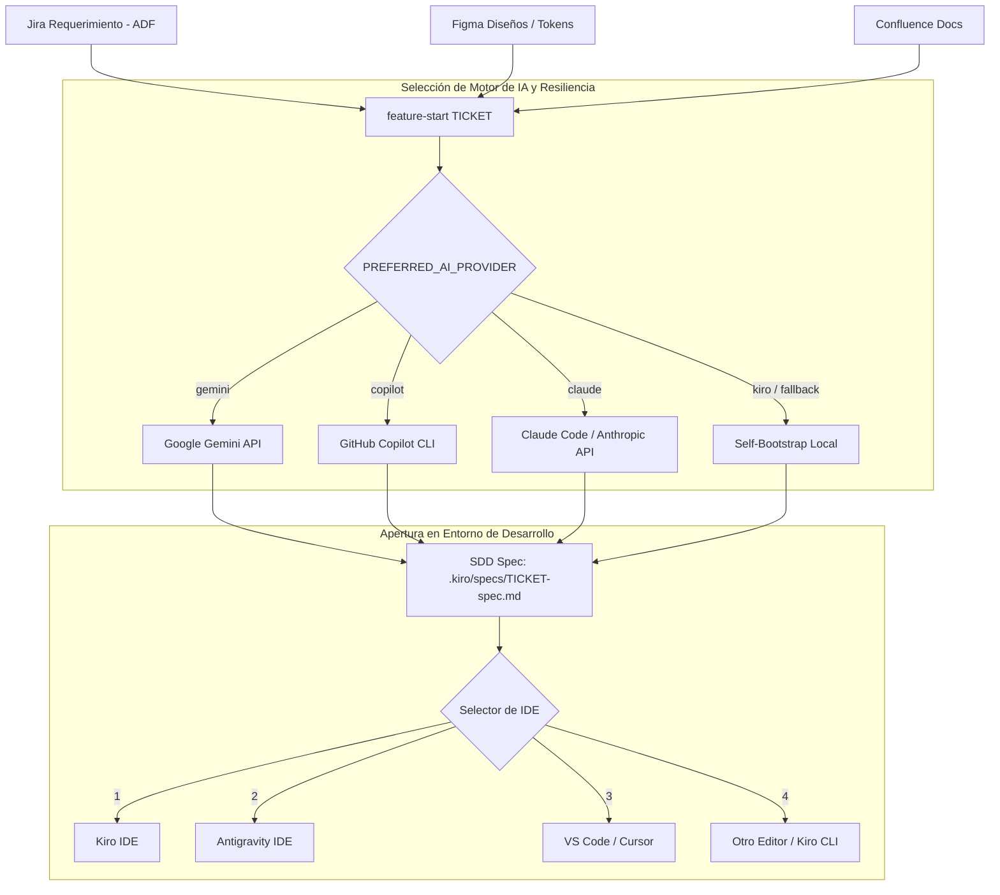

# 🚀 feature-start CLI: AI-Driven Feature Onboarding & SDD Specification Engine

> **Herramienta CLI de orquestación multi-agente basada en Spec-Driven Development (SDD): extrae requerimientos desde Jira, Figma y Confluence, gestiona ramas Git, sintetiza especificaciones técnicas BDD con el motor de IA de tu preferencia y abre el proyecto en tu IDE favorito.**

---

## 🏛️ ¿Qué es `feature-start`?

`feature-start` es un asistente CLI agnóstico de editor y de modelo de IA que acelera el ciclo de desarrollo eliminando tareas repetitivas y garantizando que el desarrollador comience con contexto técnico completo:

1. **Ingesta de Requerimientos:** Consulta el ticket en Jira (parseando formato ADF, criterios de aceptación, descripción y subtareas técnicas).
2. **Extracción de Diseños y Docs:** Descarga automáticamente componentes y assets desde Figma y páginas técnicas de Confluence vinculadas al requerimiento.
3. **Gestión de Ramas Git:** Detecta o asocia los repositorios correspondientes y prepara una rama de trabajo `feature/<TICKET>-<slug>`.
4. **Síntesis SDD & BDD con Análisis de Brecha:** Genera una especificación técnica en Markdown (`.kiro/specs/<TICKET>-spec.md`) alineando criterios de aceptación Gherkin y subtareas obligatorias. Si detecta requerimientos sin subtarea, sugiere Unidades de Trabajo adicionales (`[Sugerido por Arquitectura]`).
5. **Apertura Multi-Editor:** Te pregunta en qué IDE deseas continuar (**Kiro IDE**, **Antigravity IDE**, **VS Code**, **Cursor**, **Kiro CLI** o cualquier editor personalizado) y recuerda tu preferencia.



---

## 📦 Componentes Incluidos

La suite se compone de 5 herramientas ligeras y desacopladas en `bin/`:

| Binario | Propósito |
| :--- | :--- |
| **`feature-start`** | Orquestador principal de flujo, gestión de ramas, síntesis SDD y selector de editor. |
| **`jira-cli`** | Cliente CLI para consultar tickets Jira en JSON y formato texto con soporte ADF nativo. |
| **`figma-cli`** | Extractor de metadatos, componentes y descarga de assets PNG/SVG desde enlaces de Figma. |
| **`confluence-cli`** | Lector y extractor de páginas de documentación técnica y diagramas de Confluence. |
| **`ask-gemini`** | Conector liviano con Google Gemini API, con reintento por cuota y auto-continuación. |

---

## 🤖 Motores de IA y Resiliencia (Multi-Licencia)

Cada miembro del equipo puede usar el motor de IA para el que tenga licencia o preferencia, configurado en `~/.config/aidlc/config.env` (`PREFERRED_AI_PROVIDER`) o al vuelo con `--ai=`:

- **`gemini` (Google Gemini API):** Genera la especificación BDD rápidamente usando tu API Key de Google AI Studio. Si alcanza límite de cuota (`HTTP 429`), cae automáticamente a Copilot o Self-Bootstrap.
- **`copilot` (GitHub Copilot CLI):** Utiliza tu licencia de Copilot directamente (`copilot -p`) sin requerir clave de Gemini.
- **`claude` (Claude Code CLI / Anthropic API):** Usa tu suscripción de Claude Pro/Max/Team mediante `claude -p` o bien tu `ANTHROPIC_API_KEY`.
- **`kiro` (Kiro / IDE Local - Self-Bootstrap):** No depende de APIs externas; ensambla de forma determinista el artefacto SDD con todos los datos crudos de Jira, Figma y estructura del repositorio para que tu agente local (en Antigravity, Kiro, Cursor o VS Code) complete el plan al abrir el proyecto.

---

## 💻 Editores Compatibles (SDD Agnóstico)

Sin importar qué IDE utilice cada persona del equipo, todos trabajan sobre el mismo artefacto maestro `.kiro/specs/<TICKET>-spec.md` bajo metodología **Spec-Driven Development (SDD)**. Al finalizar `feature-start`, el CLI muestra un selector interactivo:

1. **🖥️ Kiro IDE:** Abre el workspace y la especificación en Kiro.
2. **🪐 Antigravity IDE:** Abre el repositorio y la especificación en Google Antigravity.
3. **💻 Visual Studio Code (VS Code):** Abre el proyecto con `code` o la aplicación de escritorio.
4. **⚡ Cursor:** Abre el proyecto en Cursor.
5. **📟 Kiro CLI:** Inicia una sesión interactiva en la terminal.
6. **✏️ Otro editor:** Permite ingresar cualquier comando personalizado (`webstorm`, `idea`, `zed`, etc.).
7. **🚪 Ninguno:** Prepara ramas y archivos sin abrir ningún editor.

> La primera vez que elijas un editor, `feature-start` te preguntará si deseas guardarlo como predeterminado (`PREFERRED_EDITOR`) para que en futuras ejecuciones solo presiones `Enter`.

---

## 🔒 Seguridad y Privacidad (Zero Secrets)

- **Sin secretos en el código:** Ningún token de API, correo corporativo ni URL privada está quemado en el repositorio.
- **Almacenamiento Local Aislado:** La configuración personal se almacena en `~/.config/aidlc/config.env` con permisos estrictos de usuario (`chmod 600`).
- **Onboarding Guiado:** Si ejecutas `feature-start` por primera vez, un asistente interactivo en la terminal te guiará paso a paso para configurar tus accesos una sola vez.

---

## ⚡ Instalación Rápida

### Requisitos Previos
- **macOS** o **Linux**
- **Node.js** >= 18.0.0
- **Git** >= 2.30.0

### Pasos de Instalación

1. Clona este repositorio:
   ```bash
   git clone https://github.com/MiguelRmar/aidlc-cli-toolkit.git ~/Documents/GitHub/aidlc-cli-toolkit
   cd ~/Documents/GitHub/aidlc-cli-toolkit
   ```

2. Ejecuta el instalador:
   ```bash
   ./install.sh
   ```

3. Asegúrate de tener `~/.local/bin` en tu `PATH`. Si no lo tienes, agrégalo a tu `~/.zshrc` o `~/.bashrc`:
   ```bash
   export PATH="$HOME/.local/bin:$PATH"
   ```

---

## 🛠️ Configuración Inicial

Tienes dos formas de configurar tus credenciales y entorno:

### Opción 1: Asistente Interactivo Automático (Recomendada)
Simplemente ejecuta `feature-start` con cualquier ticket (por ejemplo `feature-start PROJ-101`). Si es tu primera vez o falta alguna variable, el asistente interactivo te solicitará en consola:

1. **📁 Directorio de Repositorios (`PROJECTS_BASE_DIR`):** La carpeta local donde clonas tus proyectos (por defecto: `~/Documents/GitHub`).
2. **🌐 URL de Jira (`JIRA_URL`):** La dirección base de tu Jira en Atlassian (ej: `https://tu-organizacion.atlassian.net`).
3. **📚 URL de Confluence (`CONFLUENCE_URL`):** La dirección de la wiki (se sugiere automáticamente `${JIRA_URL}/wiki`).
4. **📧 Correo Atlassian (`JIRA_USERNAME`):** Tu correo electrónico con el que accedes a Jira/Confluence.
5. **🔑 API Token de Atlassian (`JIRA_API_TOKEN`):** Tu token generado en [https://id.atlassian.com/manage-profile/security/api-tokens](https://id.atlassian.com/manage-profile/security/api-tokens).
6. **🤖 Motor de IA Preferido (`PREFERRED_AI_PROVIDER`):** Elige cómo generar el plan SDD según tu licencia:
   - `gemini`: Google Gemini API (solicita tu `GEMINI_API_KEY` gratuita de AI Studio).
   - `copilot`: GitHub Copilot CLI (usa tu licencia de Copilot sin necesidad de key de Gemini).
   - `kiro`: Modo Local / Self-Bootstrap (no requiere APIs externas; ensambla el contexto desde Jira para que tu IDE lo complete).
7. **🎨 Figma Token (`FIGMA_ACCESS_TOKEN`):** Opcional, para descargar componentes si tu ticket incluye mockups.

El asistente guardará automáticamente tus datos en `~/.config/aidlc/config.env` con permisos restringidos de usuario (`chmod 600`).

### Opción 2: Configuración Manual
Si prefieres definirlo antes de la primera ejecución:

```bash
# 1. Crear carpeta de configuración
mkdir -p ~/.config/aidlc

# 2. Copiar la plantilla
cp templates/config.env.example ~/.config/aidlc/config.env

# 3. Editar con tu editor favorito
nano ~/.config/aidlc/config.env
```

Contenido de referencia para `~/.config/aidlc/config.env`:

```bash
# Directorio donde se encuentran tus repositorios locales
PROJECTS_BASE_DIR="$HOME/Documents/GitHub"

# Atlassian (Jira & Confluence)
JIRA_URL="https://tu-organizacion.atlassian.net"
CONFLUENCE_URL="https://tu-organizacion.atlassian.net/wiki"
JIRA_USERNAME="tu-correo@empresa.com"
JIRA_API_TOKEN="tu-api-token"

# Motor de IA preferido: "gemini", "copilot" o "kiro"
PREFERRED_AI_PROVIDER="gemini"

# Google Gemini API (Solo requerida si PREFERRED_AI_PROVIDER="gemini")
GEMINI_API_KEY="tu-gemini-api-key"

# Figma (Opcional - para extracción de mockups)
FIGMA_ACCESS_TOKEN="tu-figma-token"

# Editor preferido al finalizar feature-start (Opcional):
# Valores: "kiro", "antigravity", "vscode", "cursor", "kiro-cli"
PREFERRED_EDITOR="antigravity"
```

---

## 🚦 Uso Diario

Para comenzar a trabajar en cualquier requerimiento:

```bash
feature-start PROJ-101
```

O si deseas forzar la regeneración de contexto o elegir el motor de IA al vuelo:
```bash
feature-start PROJ-101 --refresh
feature-start PROJ-101 --ai=copilot   # Opciones: gemini, copilot, claude, kiro
```

---

## 📄 Licencia

Distribuido bajo la Licencia MIT. Consulta `LICENSE` para más información.
