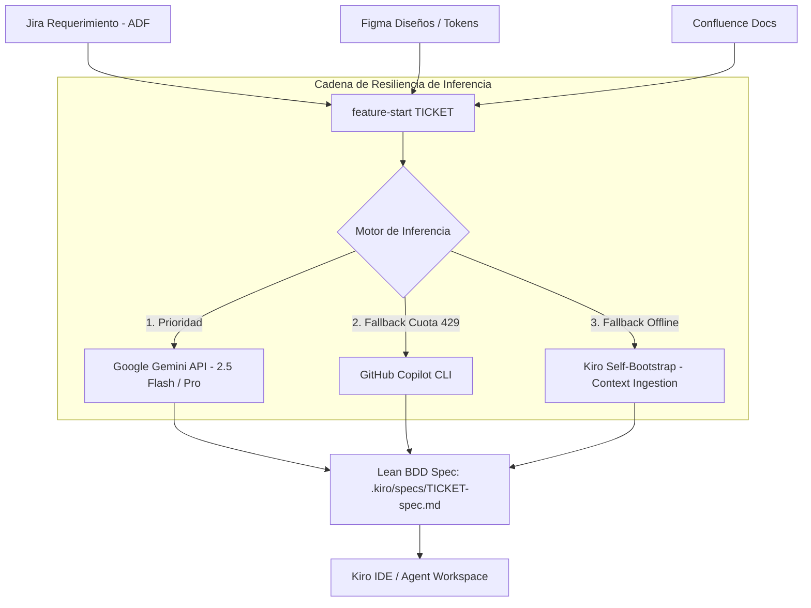

# 🚀 feature-start CLI: AI-Driven Feature Onboarding & BDD Specification Engine

> **Herramienta CLI de orquestación multi-agente diseñada para automatizar el inicio de cualquier tarea de desarrollo: extrae requerimientos desde Jira, Figma y Confluence, gestiona ramas Git y sintetiza especificaciones técnicas BDD con triple fallback de IA.**

---

## 🏛️ ¿Qué es `feature-start`?

`feature-start` es un asistente CLI de inicio rápido que acelera el ciclo de desarrollo agéntico eliminando tareas repetitivas y garantizando que el desarrollador comience con contexto técnico completo:

1. **Ingesta de Requerimientos:** Consulta el ticket en Jira (parseando formato ADF, criterios de aceptación, descripción y subtareas técnicas).
2. **Extracción de Diseños y Docs:** Descarga automáticamente componentes y assets desde Figma y diagramas/páginas de Confluence vinculadas al requerimiento.
3. **Gestión de Ramas Git:** Detecta o asocia los repositorios correspondientes y prepara una rama de trabajo `feature/<TICKET>-<slug>`.
4. **Síntesis BDD & Análisis de Brecha:** Genera una especificación técnica en Markdown (`.kiro/specs/<TICKET>-spec.md`) alineando criterios de aceptación y subtareas obligatorias. Si detecta requerimientos sin subtarea, sugiere Unidades de Trabajo adicionales (`[Sugerido por Arquitectura]`).
5. **Apertura de Entorno Agéntico:** Lanza Kiro IDE (o el editor de tu elección) precargando el contexto y el plan de trabajo.



---

## 📦 Componentes Incluidos

La suite se compone de 5 herramientas ligeras y desacopladas en `bin/`:

| Binario | Propósito |
| :--- | :--- |
| **`feature-start`** | Orquestador principal de flujo, gestión de ramas, síntesis de spec y apertura de editor. |
| **`jira-cli`** | Cliente CLI para consultar tickets Jira en JSON y formato texto con soporte ADF nativo. |
| **`figma-cli`** | Extractor de metadatos, componentes y descarga de assets PNG/SVG desde enlaces de Figma. |
| **`confluence-cli`** | Lector y extractor de páginas de documentación técnica y diagramas de Confluence. |
| **`ask-gemini`** | Conector liviano con Google Gemini API, con reintento por cuota y auto-continuación. |

---

## 🛡️ Resiliencia y Fallback de Inferencia

`feature-start` está diseñado para no fallar nunca aunque los servicios de IA externos tengan límites de cuota:
- **Nivel 1 (Google Gemini API):** Genera la especificación estructurada con escenarios BDD en segundos.
- **Nivel 2 (GitHub Copilot CLI):** Se activa automáticamente si la API de Gemini devuelve errores `HTTP 429` (Quota Exceeded) o falta de créditos.
- **Nivel 3 (Kiro Self-Bootstrap):** Si ninguna API remota está disponible (o no hay conexión), ensambla el artefacto de especificación directamente desde los datos crudos de Jira con subtareas mapeadas para que el agente local de Kiro lo procese al abrir el workspace.

---

## 🔒 Seguridad y Privacidad (Zero Secrets)

- **Sin secretos en el código:** Ningún token de API, correo corporativo ni clave privada está quemado en el repositorio.
- **Almacenamiento Local Aislado:** La configuración personal se almacena en `~/.config/aidlc/config.env` con permisos estrictos de lectura (`chmod 600`).
- **Onboarding Guiado:** Si ejecutas `feature-start` por primera vez, un asistente interactivo en la terminal te guiará paso a paso para configurar tus credenciales una sola vez.

---

## ⚡ Instalación Rápida

### Requisitos Previos
- **macOS** o **Linux**
- **Node.js** >= 18.0.0
- **Git** >= 2.30.0

### Pasos de Instalación

1. Clona este repositorio:
   ```bash
   git clone https://github.com/MiguelRmar/aidlc-cli-toolkit.git ~/Documents/GitHub/aidlc-cli-toolkit
   cd ~/Documents/GitHub/aidlc-cli-toolkit
   ```

2. Ejecuta el instalador:
   ```bash
   ./install.sh
   ```

3. Asegúrate de tener `~/.local/bin` en tu `PATH`. Si no lo tienes, agrégalo a tu `~/.zshrc` o `~/.bashrc`:
   ```bash
   export PATH="$HOME/.local/bin:$PATH"
   ```

---

## 🛠️ Configuración Inicial

Tienes dos formas de configurar tus credenciales y entorno:

### Opción 1: Asistente Interactivo Automático (Recomendada)
Simplemente ejecuta `feature-start` con cualquier ticket (por ejemplo `feature-start PROJ-101`). Si es tu primera vez o falta alguna variable, el asistente interactivo te solicitará en consola:

1. **📁 Directorio de Repositorios (`PROJECTS_BASE_DIR`):** La carpeta local donde clonas tus proyectos (por defecto: `~/Documents/GitHub`).
2. **🌐 URL de Jira (`JIRA_URL`):** La dirección base de tu Jira en Atlassian (ej: `https://tu-organizacion.atlassian.net`).
3. **📚 URL de Confluence (`CONFLUENCE_URL`):** La dirección de la wiki (se sugiere automáticamente `${JIRA_URL}/wiki`).
4. **📧 Correo Atlassian (`JIRA_USERNAME`):** Tu correo electrónico con el que accedes a Jira/Confluence.
5. **🔑 API Token de Atlassian (`JIRA_API_TOKEN`):** Tu token generado en [https://id.atlassian.com/manage-profile/security/api-tokens](https://id.atlassian.com/manage-profile/security/api-tokens).
6. **🤖 Gemini API Key (`GEMINI_API_KEY`):** Tu clave gratuita obtenida en [https://aistudio.google.com/app/apikey](https://aistudio.google.com/app/apikey).
7. **🎨 Figma Token (`FIGMA_ACCESS_TOKEN`):** Opcional, para descargar componentes si tu ticket incluye mockups.

El asistente guardará automáticamente tus datos en `~/.config/aidlc/config.env` con permisos restringidos de usuario (`chmod 600`).

### Opción 2: Configuración Manual
Si prefieres definirlo antes de la primera ejecución:

```bash
# 1. Crear carpeta de configuración
mkdir -p ~/.config/aidlc

# 2. Copiar la plantilla
cp templates/config.env.example ~/.config/aidlc/config.env

# 3. Editar con tu editor favorito
nano ~/.config/aidlc/config.env
```

Contenido de referencia para `~/.config/aidlc/config.env`:

```bash
# Directorio donde se encuentran tus repositorios locales
PROJECTS_BASE_DIR="$HOME/Documents/GitHub"

# Atlassian (Jira & Confluence)
JIRA_URL="https://tu-organizacion.atlassian.net"
CONFLUENCE_URL="https://tu-organizacion.atlassian.net/wiki"
JIRA_USERNAME="tu-correo@empresa.com"
JIRA_API_TOKEN="tu-api-token"

# Google Gemini API (Para inferencia del plan)
GEMINI_API_KEY="tu-gemini-api-key"

# Figma (Opcional - para extracción de mockups)
FIGMA_ACCESS_TOKEN="tu-figma-token"
```

---

## 🚦 Uso Diario

Para comenzar a trabajar en cualquier requerimiento:

```bash
feature-start PROJ-101
```

O si deseas forzar la regeneración de contexto:
```bash
feature-start PROJ-101 --refresh
```

---

## 📄 Licencia

Distribuido bajo la Licencia MIT. Consulta `LICENSE` para más información.
